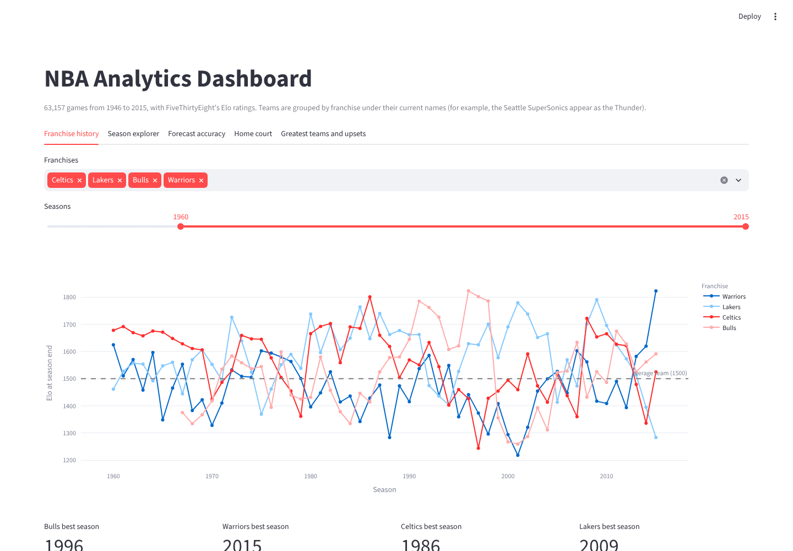
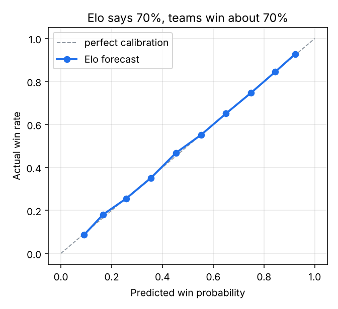
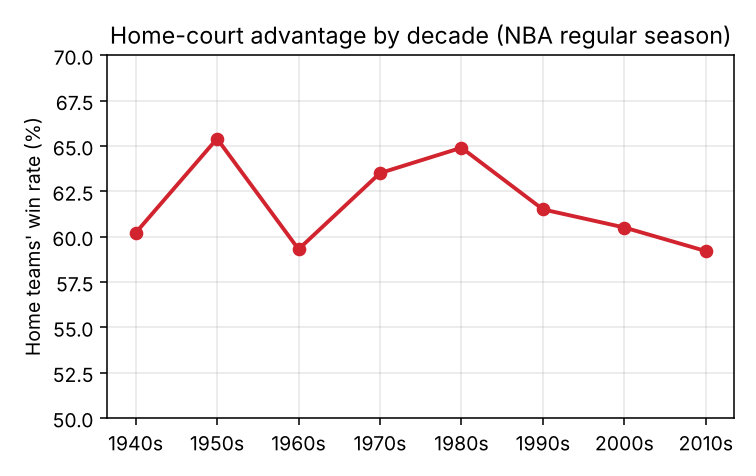
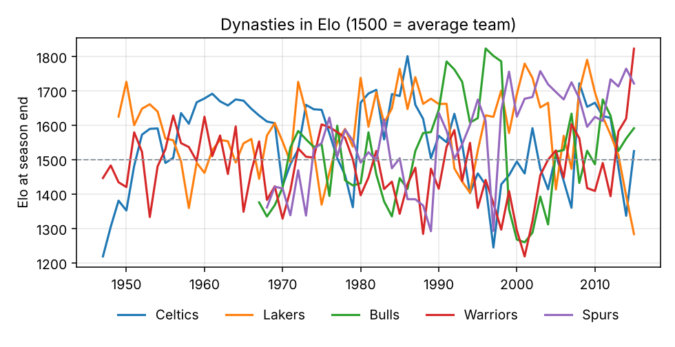
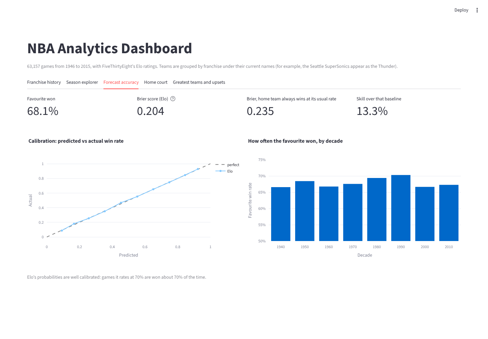

# Sports Analytics Dashboard

**An interactive NBA analytics dashboard on 63,157 games (1946 to 2015). It tracks franchise strength over time, tests how accurate Elo's win predictions really are, measures home-court advantage across decades, and ranks the greatest teams and biggest upsets.**




## Data

[FiveThirtyEight's NBA Elo dataset](https://github.com/fivethirtyeight/data/tree/master/nba-elo) (CC BY 4.0): every NBA and ABA game from 1946 to June 2015, with each team's Elo rating before and after the game and a pre-game win probability. Elo is a rating system where 1500 is an average team and ratings move after every game depending on the result and how surprising it was. Details in [data/README.md](data/README.md).

## Key findings

**1. Elo's predictions are well calibrated.** When Elo gives a team a 70% chance, teams in that bucket win about 70% of the time, across every probability band.

| Measure | Result |
| --- | --- |
| Favourite won | **68.1%** of games |
| Brier score, Elo (lower is better) | **0.204** |
| Brier score, coin flip | 0.250 |
| Brier score, "home team wins at its usual rate" | 0.235 |
| Elo's skill over that baseline | **13.3%** |

**2. A learned model didn't beat it.** I trained a logistic regression on rating difference and home court using games before 2000, and tested it on 20,546 games from 2000 to 2015. It scored a Brier of 0.2083 against Elo's 0.2077. Elo is already tuned close to the best this information allows, and checking that before building something more complex is part of good modelling.

<p align="center">
  
  
</p>

**3. Home-court advantage has shrunk.** Home teams won 65.4% of regular-season games in the 1950s and 64.9% in the 1980s, but only 59.2% in the 2010s.

**4. The 1996 Bulls are the strongest team in the data.**

| Season | Franchise | Peak Elo |
| --- | --- | --- |
| 1996 | Bulls | **1853** |
| 2015 | Warriors | 1822 |
| 1986 | Celtics | 1816 |
| 1997 | Bulls | 1811 |

**5. Biggest upset:** on 24 April 1993, the Mavericks beat the Rockets 128 to 123 with a pre-game win chance of just 2.7%.



## The dashboard

| Tab | What it shows |
| --- | --- |
| Franchise history | Compare any franchises' season-end Elo over a chosen range of seasons |
| Season explorer | Standings for any season, plus the top six teams' Elo through that season |
| Forecast accuracy | Calibration curve, Brier scores and favourite win rate by decade |
| Home court | Home win rate and winning margin by decade |
| Greatest teams and upsets | Highest peak Elo seasons, biggest upsets, with a playoffs-only toggle |

Teams are grouped by franchise under FiveThirtyEight's current names. For example, the Seattle SuperSonics appear as the Thunder.



## Run it

```bash
git clone https://github.com/Praveenasuku/Sports-Analytics-Dashboard.git
cd Sports-Analytics-Dashboard
python -m venv .venv && source .venv/bin/activate
pip install -r requirements.txt

streamlit run app/streamlit_app.py   # open http://localhost:8501
python -m sports.report              # regenerate figures and reports/summary.json
python -m pytest -q                  # 9 tests
```

With Docker:

```bash
docker build -t nba-dashboard .
docker run -p 8501:8501 nba-dashboard
```

## Project structure

```
sports/
  data.py        download, compact and load the dataset; one-row-per-game view
  analysis.py    forecast scoring, calibration, recalibration test, home court,
                 season standings, peak teams, upsets
  report.py      figures and summary.json for this README
app/streamlit_app.py   interactive dashboard
tests/           data integrity and analysis tests (for example, 1996 Bulls went 72-10)
```

## Next steps

- **Newer seasons:** extend the data past 2015 with FiveThirtyEight's later NBA forecasts or another public source.
- **Add player data:** combine team Elo with player availability to explain upsets such as resting stars.
- **Predict, not just describe:** forecast season win totals from early-season Elo and measure the error.

---

**Praveena S**, Generative AI Engineer · [Portfolio](https://praveena-portfolio-two.vercel.app) · [LinkedIn](https://www.linkedin.com/in/praveena-suku/)
